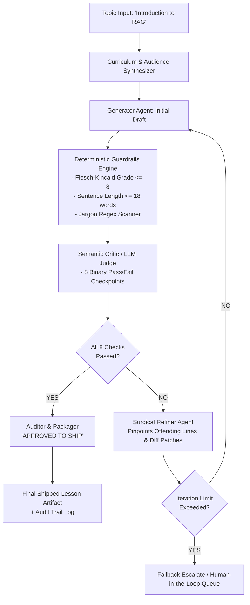
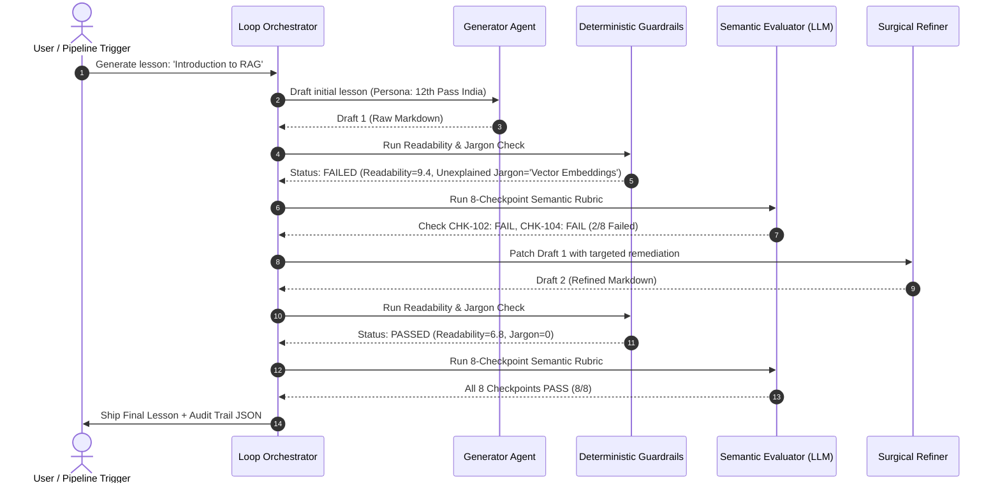

# System Architecture: Self-Evaluating Lesson Content Generator
**Role Assessment:** GenAI Engineer — Content Systems  
**Domain:** Autonomous Agentic Content Pipelines & Quality Assurance  
**Target Submission:** Introduction to RAG (Retrieval-Augmented Generation)  
**Learner Persona:** 12th-grade graduate from India (non-English medium background, limited English vocabulary, aspiring AI engineer)

---

## 1. Executive Summary & Problem Formulation

In production content systems, **"prompt-and-pray" generation is an antipattern**. A single prompt sent to a Large Language Model (LLM) cannot guarantee pedagogical validity, adherence to strict vocabulary bounds, or factual grounding. For a learner transitioning from a regional medium (e.g., Hindi, Tamil, Telugu, Marathi) to English, a single dense sentence with unexplained technical jargon causes cognitive overload and drop-off.

This system replaces single-shot generation with an **Autonomous Closed-Loop Agentic System** that:
1. **Generates** an initial lesson draft conditioned on target learner constraints and pedagogical scaffolding.
2. **Evaluates** the draft against an uncompromising **8-checkpoint Hard Pass/Fail Rubric** (no partial credit; deterministic metrics + semantic LLM judge).
3. **Reflects & Refines** surgically on failing checkpoints without degrading previously passed criteria (preventing regression oscillations).
4. **Gates Deployment**: Content is shipped to production *only* when all checkpoints score `PASS`.

---

## 2. Target Audience Modeling (The Indian 12th-Pass Persona)

### 2.1 Demographic & Cognitive Profile
- **Academic Background:** Completed 10+2 high school (CBSE/State Board), motivated to pursue practical technology/AI careers.
- **Linguistic Profile:** Learned school subjects in a regional language or semi-English medium. Comfortable with everyday conversational English (CEFR A2/B1 level), but easily intimidated by academic jargon, complex nested clauses, and passive voice.
- **Cultural Schema:** Resonates strongly with everyday Indian experiences:
  - *Board Examinations & Open-Book vs Closed-Book Tests*
  - *The College Library & the Librarian's Register*
  - *The Neighborhood Kirana Store / Munshi ji's Ledger*
  - *Train ticket reservation counters & IRCTC booking confirmation*

### 2.2 Pedagogical Rules of Engagement
1. **The "Analogy Before Definition" Principle:** Never name a technical concept without first introducing an intuitive physical analogy.
2. **Sentence Economy:** Hard ceiling of 18 words per sentence; average sentence length target of 11–13 words.
3. **Zero Unexplained Jargon:** Any term like *LLM*, *Hallucination*, *Vector Database*, *Embeddings*, or *Prompt* must be translated immediately into everyday words.
4. **Active Scaffolding:** Continuous checkpoints (knowledge checks with clear feedback) rather than continuous unbroken text.

---

## 3. The 8-Checkpoint Hard Pass/Fail Rubric

Unlike academic evaluations that give "7/10" (which allows severe bugs to slip into production), our content system uses **binary pass/fail gates**. A single failure halts publication.

| Checkpoint ID | Dimension | Name | Evaluation Mechanism | Pass Criteria |
|---|---|---|---|---|
| `CHK-101` | **Accurate & Grounded** | `factual_accuracy_and_grounding` | LLM Judge + Fact Verification | Technically true; RAG is accurately distinguished from fine-tuning; no false claims. |
| `CHK-102` | **Beginner Language** | `target_persona_readability` | Deterministic Algorithm | Flesch-Kincaid Grade Level <= 8.0, average sentence length <= 18 words. |
| `CHK-103` | **Teaches by Example** | `relatable_cultural_analogy` | LLM Judge + Keyword Scanner | Uses a concrete, relatable anchor analogy (Open-Book Exam / Library Register) mapped to R, A, and G. |
| `CHK-104` | **No Unexplained Jargon** | `zero_unexplained_jargon` | Regex Parser + Semantic Matcher | Every technical term is explained in plain English before or at first mention. |
| `CHK-105` | **Key Points Coverage** | `three_pillar_curriculum` | Section AST Parser + Judge | Explicitly covers all three required pillars: What it is, Why it matters, and How it works. |
| `CHK-106` | **Coherent Flow** | `pedagogical_sequence` | Structural Hierarchy Matcher | Logical order: Hook → Analogy → Breakdown → Flow Diagram → Example → Career Value → Quiz. |
| `CHK-107` | **Visual Scaffolding** | `visual_structure_and_diagrams` | Markdown AST Analyzer | Includes structured formatting, callout blocks, and an ASCII/Mermaid flow diagram. |
| `CHK-108` | **Active Learning** | `comprehension_verification` | Quiz Parser + Answer Verifier | Contains at least 2 multiple-choice questions with explicit explanations for right and wrong choices. |

---

## 4. Multi-Agent Orchestration & Self-Correction Dynamics

### 4.1 Agent Roles & Responsibilities

1. **Curriculum Planner:**
   - Decomposes the user input topic into prerequisite knowledge chains and explicit pedagogical constraints tailored to the learner persona.
2. **Draft Generator Agent:**
   - Synthesizes the initial draft using structured prompt templates infused with cultural anchor patterns and tone constraints.
3. **Deterministic Guardrails Engine:**
   - Runs before LLM evaluation to catch objective violations (e.g., Flesch-Kincaid reading score, average sentence word count, forbidden acronyms without parenthetical expansions). Fast (<5ms), zero-cost, deterministic.
4. **Evaluator / Critic Agent:**
   - Evaluates subjective and semantic checkpoints. Emits a structured JSON audit with a boolean flag for each check, exact offending snippets, and precise remediation directives.
5. **Surgical Refiner Agent:**
   - **Crucial Engineering Decision:** Rather than issuing a generic "rewrite the whole lesson" prompt (which causes regression loops where fixing one bug breaks an already passing check), the Refiner uses a **Targeted Patch Protocol**:
     - It receives the previous draft, the pass/fail matrix, the exact failing excerpts, and explicit revision guidance.
     - It is instructed to freeze passing sections and modify only the deficient blocks.

---

## 5. Preventing Loop Failure Modes & Oscillation

Agentic self-evaluation loops in production often suffer from three chronic failure modes:

| Failure Mode | Manifestation | Engineering Solution in this System |
|---|---|---|
| **Rubric Whack-a-Mole** | Generator fixes Jargon (CHK-104), but adds long explanation sentences that breach Readability (CHK-102). | **Surgical Patching with Constraint Anchoring:** Prompts explicitly inform the model of which constraints are currently passing and must NOT be violated during the rewrite. |
| **Infinite Oscillation** | Draft alternates between two styles without converging. | **Hard Iteration Cap (Max 3-5 Rounds)** + **Convergence Delta Scoring**. If progress stalls, the system triggers graceful degradation or human review escalation. |
| **Hallucinated Evaluation** | An LLM judge gives arbitrary grades or becomes overly sycophantic. | **Hybrid Evaluation:** Combining deterministic code-level tests (regex, token counts, syllable stats) with few-shot calibrated LLM prompts enforcing structured JSON schema outputs. |

---

## 6. Telemetry, Traceability & Audit Logs

Every single run produces a comprehensive `audit_trail_<topic>.json` artifact recording:
- Generation timestamp, model metadata, and latency.
- Iteration index and full draft markdown snapshot.
- Detailed pass/fail matrix across all 8 checkpoints with cited line numbers.
- Exact critic feedback emitted to the refiner.
- Final shipping decision: `APPROVED_TO_SHIP` or `REJECTED_MAX_ITERATIONS`.

This provides complete enterprise traceability: any stakeholder can inspect why a draft was rejected and how the agent corrected it.

---

## 7. Production Roadmap & Cost-Latency Tradeoffs

In a high-throughput production environment (generating thousands of curriculum modules per day):
1. **Model Cascading:**
   - Use a lightweight, fast model (e.g., Gemini 1.5 Flash / GPT-4o-mini) for deterministic guardrails, jargon extraction, and the semantic judge.
   - Use a higher-parameter reasoning model only for the initial synthesis and complex surgical patches.
2. **Semantic Caching:**
   - Cache validated explanations of recurring core concepts (e.g., the "Open-Book Exam" analogy) in a vector registry to reduce repeat token costs.
3. **Parallelized Checkpoint Evaluation:**
   - Checkpoints CHK-101 through CHK-108 can be evaluated concurrently in async threads, reducing evaluation latency from 6s to <1.5s per round.
